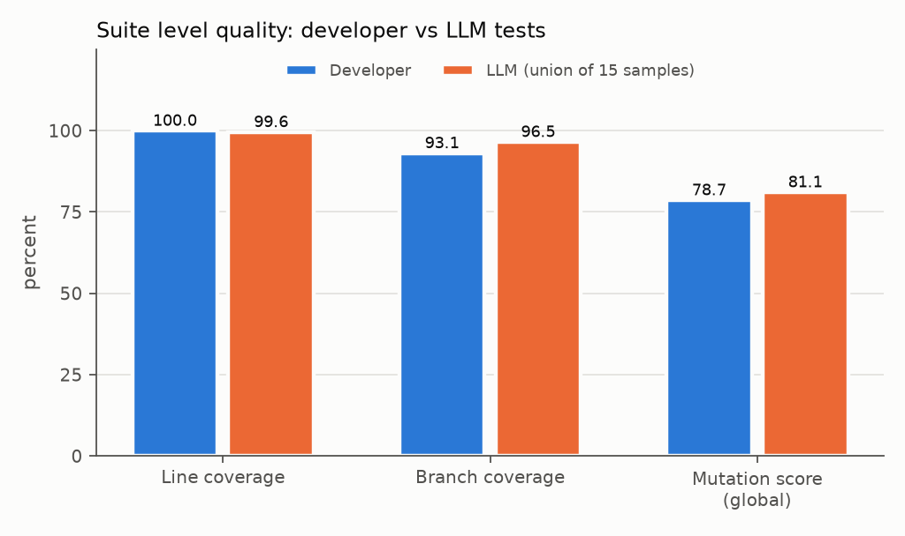
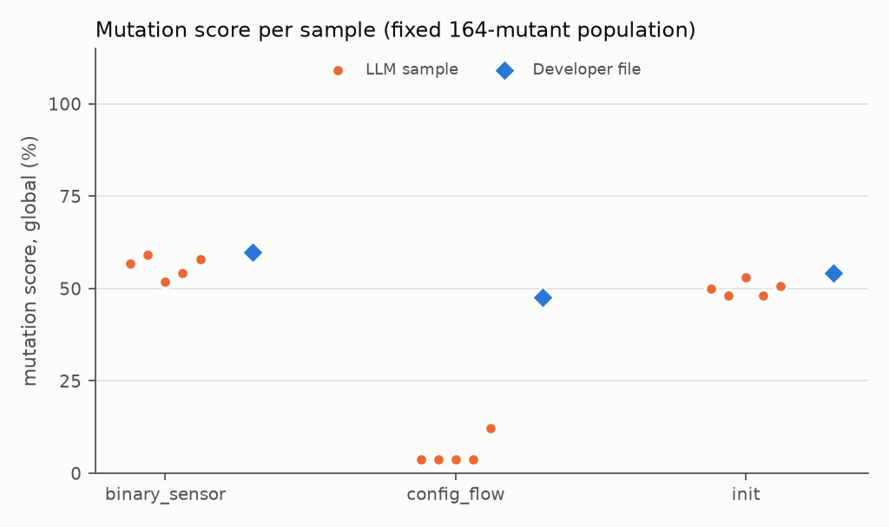
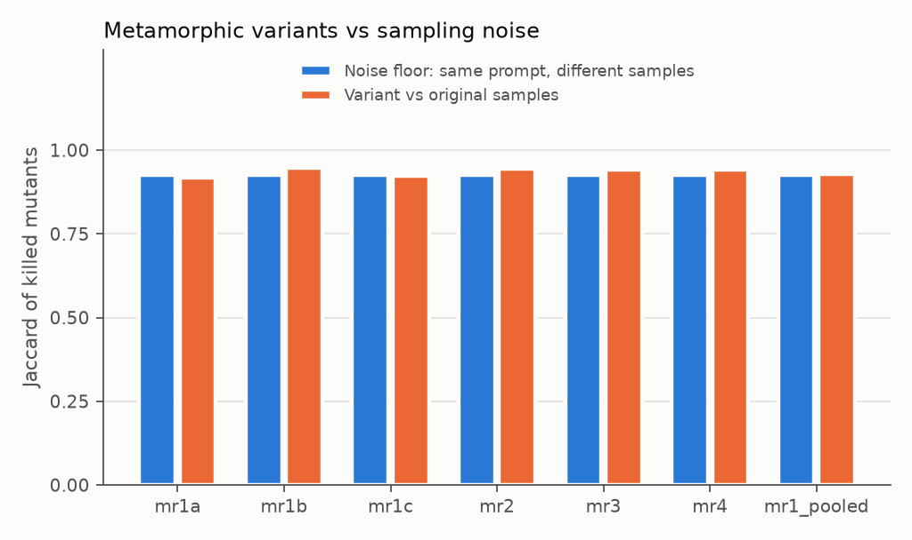

# Abstract

LLM generated unit tests are usually judged by whether they run and cover code. We ask whether
they are also good tests. As a case study we use the Home Assistant `threshold` integration,
whose developer tests already reach 100.0 % line coverage. Claude Sonnet 5.5 generated
five samples for each of three target modules, and we compare them with the developer tests on
seven quality measures, among them mutation score and test smells.
Of the generated tests, 97.6 % pass stably. Coverage could not separate the suites;
mutation score could. A single sample is clearly weaker than the developer file, especially for
the configuration flow (mutants killed: 5.4 % against
47.6 %), and the union of all samples overtakes the developers only with about
2.5 times as many tests. Automatic scores agree only weakly with a blinded manual
review of 60 tests (best: relevance, Spearman $\rho$ = 0.30).
Metamorphic prompt changes show no clear effect beyond sampling noise.

> **Note.** The behaviour list (`data/behaviours.yaml`) used for relevance and completeness is a
> *draft* until the author has checked it.

# Introduction

Large language models can write unit tests, and several systems report that a large share of the
generated tests compile, run, and add coverage [@alshahwan2024testgenllm; @schafer2024testpilot;
@lemieux2023codamosa]. Coverage alone is a weak statement about test *quality*, however: a test
suite can execute every line and still miss most defects. This study assesses LLM generated unit
tests along several automatically measurable dimensions and checks the automatic scores against a
blinded manual review.

The case study is the `threshold` integration of Home Assistant core (tag 2026.10.1), a small
component with an entity, a configuration flow and a migration path. Its developers' tests form
the human baseline and already reach complete line coverage, which is why branch coverage and
mutation score are the main comparison measures.

We ask three research questions.

- **RQ1.** How do LLM generated tests compare with the developers' tests on executability,
  coverage, mutation score, traceability, maintainability (test smells), relevance and
  completeness?
- **RQ2.** How well do the automatic scores agree with a blinded manual review of a sample
  (Spearman's $\rho$, weighted Cohen's $\kappa$)?
- **RQ3.** How sensitive are generated tests to metamorphic changes of the prompt (paraphrase,
  renamed local variables, reordered functions, stripped comments), compared with the normal noise
  between repeated samples?

# Related work

*LLM based unit test generation.* TestGen-LLM at Meta [@alshahwan2024testgenllm] filters generated
Kotlin tests through build, pass, and coverage-improvement checks before accepting them.
TestPilot [@schafer2024testpilot] evaluates LLM generated tests for JavaScript packages and uses
failure feedback to repair them. CodaMosa [@lemieux2023codamosa] couples search based test
generation with an LLM to escape coverage plateaus. ChatUniTest [@chen2024chatunitest] is a
framework for Java that follows a generate, validate, repair loop, and CoverUp
[@pizzorno2025coverup] drives Python test generation with coverage feedback. A survey
[@wang2024survey] organises the wider field of software testing with LLMs.

*Test quality beyond coverage.* Mutation testing [@jia2011mutation] estimates fault detection
ability by injecting small syntactic faults. Siddiq et al. [@siddiq2024junit] study LLM generated
JUnit tests and report on test smells in them; PyNose [@wang2021pynose] is a test smell detector
for Python, which motivates our own AST based detector. Test-to-code traceability links have been
recovered by combining several signals [@white2020tctracer], an idea we reuse in a light form.

*Robustness.* ReCode [@wang2023recode] evaluates code generation models under semantics
preserving perturbations of prompts. Metamorphic testing [@chen2018metamorphic] provides the
general idea of relating outputs of related inputs, which we apply to the generation prompt.

# Method

**Pipeline.** The `testquality` tool (this repository) generates tests with the Anthropic Messages
API, runs them in the Home Assistant checkout as a subprocess, and computes all metrics from
the run artefacts. Every LLM call is logged in full (`data/runs/<run>/calls.jsonl`). The developers'
tests are never shown to the model: a prompt contains only the integration's own source files
and the tool aborts if a developer test name occurs in a prompt.

**Generation.** For each of three target modules (`binary_sensor.py`, `config_flow.py`,
`__init__.py`) one prompt asks for a pytest module; every test must carry a docstring with
`Behaviour:` and `Target:` lines. $k = 5$ samples per prompt are drawn to measure the noise floor.
No sampling parameters are sent. The main model is `claude-sonnet-5-5`.

**Metrics** (full definitions in `docs/metrics.md`).

- *Executability*: collect rate, pass rate over three repeated runs, flaky rate, and failure types.
  Only stably passing tests are *valid* and count for every other metric.
- *Coverage*: line and branch coverage of the component (coverage.py with per-test contexts).
- *Mutation score*: mutmut 3.x on the component. We report the score over a fixed population of
  mutants (killed / all) and the conventional killed / (killed + survived).
- *Traceability*: the function suggested by the test name, the last component function entered
  before the first assertion (dynamic trace), and the declared `Target:` are compared and scored
  0, 0.5 or 1.
- *Maintainability*: ten test smells with a custom AST detector.
- *Relevance and completeness*: a draft list of behaviours with code line ranges; a test is
  relevant if it exercises a listed behaviour, and completeness is the share of behaviours
  exercised.
- *Manual review (RQ2)*: 60 tests (20 developer, 40 LLM) in random order with the origin hidden,
  rated 1-5 on relevance, clarity of purpose, maintainability and oracle strength. Agreement is
  measured by Spearman's $\rho$ and linearly weighted Cohen's $\kappa$ [@cohen1968weighted].
- *Metamorphic sensitivity (RQ3)*: MR1 three paraphrases of the prompt; MR2 renamed local
  variables, MR3 reordered functions and methods, MR4 stripped comments in the shown source. Each
  transformation is proven meaning preserving by tests (AST equality up to renaming, equal
  definition sets). Variants are compared with the baseline samples by Mann-Whitney U
  [@mann1947test], Cliff's $\delta$ [@cliff1993dominance], and by the Jaccard overlap of covered
  lines and of killed mutants relative to the overlap between baseline samples.

# Setup

Home Assistant core is checked out at tag 2026.10.1 (branch `study-pinned`) with its own
virtual environment. The tool runs in a separate environment (Python 3.12 or newer, `uv`).
Generated tests are staged under
`tests/components/threshold/_llm_generated/<run_id>/` and removed after each run; no other
Home Assistant file is modified. Mutation testing runs in a scratch workspace outside the
Home Assistant tree. Coverage uses the `ctrace` core of coverage.py, because the default core of
Python 3.12 and newer drops per-test contexts. Model, prompt version, costs and all decisions are
recorded in `docs/DECISIONS.md`.

# Results

## Key findings

- **Executability.** 15 of 15 LLM samples collect; 97.6 % of the 294 generated tests pass in all three runs (developer tests: 100.0 %); flaky rate 0.0 %.
- **Coverage and mutation (suite level).** Line coverage 100.0 % (developer) vs 99.6 % (union of the LLM samples); branch coverage 93.1 % vs 96.5 %; mutation score over the fixed 164 mutants 78.7 % vs 81.1 %.
- **Per target mutation score (global).** binary_sensor: 56.0 % per LLM sample vs 59.8 % for the developer file; config_flow: 5.4 % per LLM sample vs 47.6 % for the developer file; init: 50.0 % per LLM sample vs 54.3 % for the developer file.
- **Traceability.** Mean name-vs-coverage score 0.378 (developer) vs 0.301 (LLM); the LLM's declared `Target:` scores 0.533, and 92.0 % of valid LLM tests carry a parsable declaration.
- **Test smells.** Share of valid tests with at least one smell: 98.3 % (developer) vs 44.2 % (LLM); smell density 2.496 vs 0.662 per test.
- **Relevance and completeness (draft behaviour list).** Relevance 99.1 % (developer) vs 91.6 % (LLM); LLM completeness 100.0 % of the 38 behaviours reachable by the developer tests.
- **Metamorphic sensitivity (binary_sensor, n=5 per variant).** mr1a: 0/7 metrics differ at p<0.05, killed-mutant overlap 0.916 vs noise floor 0.925; mr1b: 0/7 metrics differ at p<0.05, killed-mutant overlap 0.946 vs noise floor 0.925; mr1c: 1/7 metrics differ at p<0.05 (smell_density), killed-mutant overlap 0.922 vs noise floor 0.925; mr2: 0/7 metrics differ at p<0.05, killed-mutant overlap 0.944 vs noise floor 0.925; mr3: 1/7 metrics differ at p<0.05 (valid_tests), killed-mutant overlap 0.942 vs noise floor 0.925; mr4: 0/7 metrics differ at p<0.05, killed-mutant overlap 0.942 vs noise floor 0.925.
- **Agreement with manual review (RQ2, n=60).** relevance: rho 0.30, kappa 0.10; clarity: rho 0.07, kappa 0.01; maintainability: rho 0.10, kappa 0.05; oracle_strength: rho 0.19, kappa -0.00 (table in the RQ2 section).

## RQ1: generated tests versus developer tests

### Executability

| Suite | Units | Collect rate | Tests | Pass rate (mean of 3) | Stable pass rate | Flaky rate |
|---|---|---|---|---|---|---|
| developer | 3/3 | 100.0 % | 115 | 100.0 % | 100.0 % | 0.0 % |
| main_sonnet55_v1 | 15/15 | 100.0 % | 294 | 97.6 % | 97.6 % | 0.0 % |
| mr_mr1a_binary_sensor | 5/5 | 100.0 % | 128 | 100.0 % | 100.0 % | 0.0 % |
| mr_mr1b_binary_sensor | 5/5 | 100.0 % | 160 | 100.0 % | 100.0 % | 0.0 % |
| mr_mr1c_binary_sensor | 5/5 | 100.0 % | 117 | 100.0 % | 100.0 % | 0.0 % |
| mr_mr2_binary_sensor | 5/5 | 100.0 % | 160 | 100.0 % | 100.0 % | 0.0 % |
| mr_mr3_binary_sensor | 5/5 | 100.0 % | 190 | 100.0 % | 100.0 % | 0.0 % |
| mr_mr4_binary_sensor | 5/5 | 100.0 % | 146 | 100.0 % | 100.0 % | 0.0 % |

**Failure types of non-passing tests**

| Suite | Error type | Tests |
|---|---|---|
| main_sonnet55_v1 | RuntimeError | 6 |
| main_sonnet55_v1 | AssertionError | 1 |

### Coverage and mutation score (suite level)

Developer rows per target are the matching developer file; the LLM rows are the union over the k = 5 samples of that target.

| Target / scope | Suite | Tests passing | Line cov. | Branch cov. | Mutation score (global) | Mutation score (covered) |
|---|---|---|---|---|---|---|
| all | developer | 115 | 100.0 % | 93.1 % | 78.7 % | 78.7 % |
| all | LLM (union of k=5) | 287 | 99.6 % | 96.5 % | 81.1 % | 81.1 % |
| target:binary_sensor | developer | 97 | 86.2 % | 75.9 % | 59.8 % | 62.0 % |
| target:binary_sensor | LLM (union of k=5) | 145 | 86.6 % | 77.6 % | 59.2 % | 82.9 % |
| target:config_flow | developer | 9 | 84.2 % | 56.9 % | 47.6 % | 59.1 % |
| target:config_flow | LLM (union of k=5) | 80 | 76.8 % | 51.7 % | 12.2 % | 62.5 % |
| target:init | developer | 9 | 65.8 % | 25.9 % | 54.3 % | 70.6 % |
| target:init | LLM (union of k=5) | 62 | 74.4 % | 53.4 % | 57.9 % | 75.4 % |

### Per file / per sample

| Target | Developer file | LLM samples (mean ± sd, k=5) |
|---|---|---|
| binary_sensor - valid tests | 97 | 29.0 ± 4.9 |
| binary_sensor - line cov. | 86.2 % | 86.6 % ± 0.0 % |
| binary_sensor - branch cov. | 75.9 % | 77.6 % ± 0.0 % |
| binary_sensor - mutation score (global) | 59.8 % | 56.0 % ± 2.9 % |
| config_flow - valid tests | 9 | 16.0 ± 2.1 |
| config_flow - line cov. | 84.2 % | 48.9 % ± 15.6 % |
| config_flow - branch cov. | 56.9 % | 13.1 % ± 21.6 % |
| config_flow - mutation score (global) | 47.6 % | 5.4 % ± 3.8 % |
| init - valid tests | 9 | 12.4 ± 3.2 |
| init - line cov. | 65.8 % | 68.2 % ± 0.9 % |
| init - branch cov. | 25.9 % | 33.4 % ± 4.0 % |
| init - mutation score (global) | 54.3 % | 50.0 % ± 2.0 % |

### Traceability, smells, relevance, completeness

Behaviour list is a DRAFT (needs human check); completeness is relative to the behaviours the developer tests reach.

| Suite | Trace (name target) | Trace (declared target) | Declared present | Smelly tests | Smell density | Relevance | Completeness |
|---|---|---|---|---|---|---|---|
| developer | 0.378 | n/a | n/a | 98.3 % | 2.496 | 99.1 % | 100.0 % |
| LLM | 0.301 | 0.533 | 92.0 % | 44.2 % | 0.662 | 91.6 % | 100.0 % |

### Test smells (share of valid tests with the smell)

| Smell | developer | LLM |
|---|---|---|
| assertion_roulette | 97.4 % | 20.2 % |
| duplicate_assert | 6.1 % | 3.8 % |
| magic_number | 60.0 % | 27.2 % |
| conditional_logic | 79.1 % | 0.0 % |
| no_assertion | 0.0 % | 5.6 % |
| try_except | 0.0 % | 0.0 % |
| sleepy_test | 0.0 % | 0.0 % |
| redundant_print | 0.0 % | 0.0 % |
| eager_test | 0.0 % | 0.0 % |
| empty_test | 0.0 % | 0.0 % |

## RQ2: agreement with the manual review

### RQ2 agreement with manual review

| Scale | n | Spearman rho | p | Weighted kappa |
|---|---|---|---|---|
| relevance | 60 | 0.302 | 0.019 | 0.104 |
| clarity | 60 | 0.072 | 0.586 | 0.007 |
| maintainability | 60 | 0.104 | 0.427 | 0.047 |
| oracle_strength | 60 | 0.189 | 0.148 | -0.001 |

## RQ3: metamorphic sensitivity

### RQ3 metamorphic sensitivity (binary_sensor target, n = 5 samples per variant)

| Variant | Metric | Baseline mean (sd) | Variant mean | In baseline range | MWU p | Cliff's delta | Effect |
|---|---|---|---|---|---|---|---|
| mr1a | valid_tests | 29.000 (4.899) | 25.600 | 60 % | 0.2933 | -0.44 | medium |
| mr1a | line_cov | 0.866 (0.000) | 0.872 | 80 % | 0.4237 | 0.2 | small |
| mr1a | branch_cov | 0.776 (0.000) | 0.786 | 80 % | 0.4237 | 0.2 | small |
| mr1a | mut_global | 0.560 (0.029) | 0.561 | 80 % | 1.0 | -0.04 | negligible |
| mr1a | trace_name | 0.225 (0.080) | 0.252 | 100 % | 0.462 | 0.32 | small |
| mr1a | smell_density | 0.634 (0.120) | 0.710 | 40 % | 1.0 | -0.04 | negligible |
| mr1b | valid_tests | 29.000 (4.899) | 32.000 | 100 % | 0.3398 | 0.4 | medium |
| mr1b | line_cov | 0.866 (0.000) | 0.866 | 100 % | 1.0 | 0.0 | negligible |
| mr1b | branch_cov | 0.776 (0.000) | 0.776 | 100 % | 1.0 | 0.0 | negligible |
| mr1b | mut_global | 0.560 (0.029) | 0.581 | 100 % | 0.2918 | 0.44 | medium |
| mr1b | trace_name | 0.225 (0.080) | 0.220 | 100 % | 1.0 | 0.04 | negligible |
| mr1b | smell_density | 0.634 (0.120) | 0.961 | 20 % | 0.0952 | 0.68 | large |
| mr1c | valid_tests | 29.000 (4.899) | 23.400 | 80 % | 0.14 | -0.6 | large |
| mr1c | line_cov | 0.866 (0.000) | 0.863 | 80 % | 0.4237 | -0.2 | small |
| mr1c | branch_cov | 0.776 (0.000) | 0.765 | 60 % | 0.1797 | -0.4 | medium |
| mr1c | mut_global | 0.560 (0.029) | 0.526 | 80 % | 0.0917 | -0.68 | large |
| mr1c | trace_name | 0.225 (0.080) | 0.240 | 80 % | 0.5476 | 0.28 | small |
| mr1c | smell_density | 0.634 (0.120) | 0.757 | 20 % | 0.0317 | 0.84 | large |
| mr2 | valid_tests | 29.000 (4.899) | 32.000 | 80 % | 0.3976 | 0.36 | medium |
| mr2 | line_cov | 0.866 (0.000) | 0.862 | 80 % | 0.4237 | -0.2 | small |
| mr2 | branch_cov | 0.776 (0.000) | 0.765 | 80 % | 0.4237 | -0.2 | small |
| mr2 | mut_global | 0.560 (0.029) | 0.572 | 100 % | 0.5993 | 0.24 | small |
| mr2 | trace_name | 0.225 (0.080) | 0.236 | 80 % | 1.0 | 0.04 | negligible |
| mr2 | smell_density | 0.634 (0.120) | 0.687 | 80 % | 1.0 | 0.04 | negligible |
| mr3 | valid_tests | 29.000 (4.899) | 38.000 | 20 % | 0.0345 | 0.84 | large |
| mr3 | line_cov | 0.866 (0.000) | 0.866 | 100 % | 1.0 | 0.0 | negligible |
| mr3 | branch_cov | 0.776 (0.000) | 0.776 | 100 % | 1.0 | 0.0 | negligible |
| mr3 | mut_global | 0.560 (0.029) | 0.581 | 100 % | 0.2873 | 0.44 | medium |
| mr3 | trace_name | 0.225 (0.080) | 0.237 | 100 % | 0.8413 | 0.12 | negligible |
| mr3 | smell_density | 0.634 (0.120) | 0.525 | 40 % | 0.3095 | -0.44 | medium |
| mr4 | valid_tests | 29.000 (4.899) | 29.200 | 100 % | 0.8237 | 0.12 | negligible |
| mr4 | line_cov | 0.866 (0.000) | 0.862 | 80 % | 0.4237 | -0.2 | small |
| mr4 | branch_cov | 0.776 (0.000) | 0.765 | 80 % | 0.4237 | -0.2 | small |
| mr4 | mut_global | 0.560 (0.029) | 0.570 | 100 % | 0.7518 | 0.16 | small |
| mr4 | trace_name | 0.225 (0.080) | 0.206 | 60 % | 0.6905 | -0.2 | small |
| mr4 | smell_density | 0.634 (0.120) | 0.787 | 20 % | 0.0749 | 0.72 | large |
| mr1_pooled | valid_tests | 29.000 (4.899) | 27.000 | 80 % | 0.5113 | -0.2133 | small |
| mr1_pooled | line_cov | 0.866 (0.000) | 0.867 | 87 % | 1.0 | 0.0 | negligible |
| mr1_pooled | branch_cov | 0.776 (0.000) | 0.776 | 80 % | 0.7789 | -0.0667 | negligible |
| mr1_pooled | mut_global | 0.560 (0.029) | 0.556 | 87 % | 0.7918 | -0.0933 | negligible |
| mr1_pooled | trace_name | 0.225 (0.080) | 0.238 | 93 % | 0.5117 | 0.2133 | small |
| mr1_pooled | smell_density | 0.634 (0.120) | 0.809 | 27 % | 0.1186 | 0.4933 | large |

**Overlap of covered lines and of killed mutants**

| Variant | Set | Noise floor (same prompt) | Variant vs original | MWU p | Cliff's delta |
|---|---|---|---|---|---|
| mr1a | lines | 1.000 | 0.990 | 0.1401 | -0.2 |
| mr1a | killed | 0.925 | 0.916 | 0.7284 | -0.08 |
| mr1b | lines | 1.000 | 1.000 | 1.0 | 0.0 |
| mr1b | killed | 0.925 | 0.946 | 0.1293 | 0.336 |
| mr1c | lines | 1.000 | 0.995 | 0.1401 | -0.2 |
| mr1c | killed | 0.925 | 0.922 | 1.0 | 0.0 |
| mr2 | lines | 1.000 | 0.993 | 0.1401 | -0.2 |
| mr2 | killed | 0.925 | 0.944 | 0.2208 | 0.272 |
| mr3 | lines | 1.000 | 1.000 | 1.0 | 0.0 |
| mr3 | killed | 0.925 | 0.942 | 0.2341 | 0.264 |
| mr4 | lines | 1.000 | 0.993 | 0.1401 | -0.2 |
| mr4 | killed | 0.925 | 0.942 | 0.2206 | 0.272 |
| mr1_pooled | lines | 1.000 | 0.995 | 0.2273 | -0.1333 |
| mr1_pooled | killed | 0.925 | 0.928 | 0.6672 | 0.0853 |

# Discussion

**Coverage was saturated; mutation score was not.** The developer tests already execute every
line (100.0 %), and the pooled LLM samples come within a fraction of that
(99.6 %). Branch coverage (93.1 % against 96.5 %) moves a little more,
but neither number tells a reader which suite would catch more faults. The mutation score does
differentiate: it exposes how much a test actually checks, not only what it executes. This is the
main reason why the study treats mutation score as the primary quality measure.

**One sample is much weaker than the developer file.** Per target, a single LLM sample kills
56.0 % of the mutants for `binary_sensor` (developer file:
59.8 %) and 50.0 % for `__init__` (54.3 %), which is
close. For `config_flow` it kills only 5.4 % against 47.6 %.
The samples for this module mostly exercise a few functions of the flow and leave the rest
untouched, so the gap is a real property of the generated tests rather than a measurement
artefact. A user who takes one generated file would get a clearly smaller safety net than the
file the maintainers wrote.

**The union of samples wins, but only with about 2.5 times more tests.** Taking the
union of the 15 samples gives 81.1 % of the 164 mutants killed against
78.7 % for the developers, but it uses 287 stably passing tests against
115. The advantage is small and is bought with a much larger suite that someone has to
maintain; generating several samples and keeping the union is a way of trading review and
maintenance cost for fault detection, not a free improvement.

**The smell result is partly detector bias.** The developer tests show assertion roulette in
97.4 % of valid tests and conditional logic in 79.1 %, the LLM tests in
20.2 % and 0.0 %. Many developer tests are parametrised and loop over lists
of values, and the detector counts every executed case of such a function, so a single
data-driven function is counted as many smelly tests. The numbers (smelly tests:
98.3 % against 44.2 %) therefore overstate the difference in maintainability.
By this detector the LLM suite still has fewer smells, but the figure should not be read as "developers write
smelly tests".

**What RQ2 says about trusting automatic scores.** With 60 rated tests and one rater, none of
the four automatic scores agrees well with the human ratings. The best one, relevance,
reaches a Spearman $\rho$ of 0.30 and the largest weighted $\kappa$ over all
scales is 0.10, which is slight agreement at most. Relevance (derived from
covered behaviours) is weakly related to the human view; clarity (0.07),
maintainability (0.10) and oracle strength
(0.19) are not. In plain words: automatic scores are useful to screen a
large number of tests and to compare suites in aggregate, but they cannot replace a human for
judging whether a test is clear, maintainable or has a meaningful oracle. Part of the low
$\kappa$ may come from our binning of continuous scores into five levels, so $\rho$ is the fairer
figure; it is also low.

**RQ3 shows no clear prompt sensitivity, but power is low.** Across 6 variants
and their metrics, 2 of 42 comparisons are significant at $p < 0.05$, which is
about what chance alone would give without correction for multiple comparisons. The overlap of
killed mutants between a variant and the baseline (0.916 to 0.946) stays at
the level of the overlap between repeated samples of the same prompt (0.925). With
five samples per variant, however, the tests can only detect large effects, and some effect sizes
in the table are large but not significant. The honest conclusion is that we found no evidence of
sensitivity, not that there is none.

# Threats to validity

*Construct validity.* Traceability is defined operationally; entity properties that Home Assistant
reads on every state write (for example `extra_state_attributes`) often become the "last call",
which lowers the score for tests of either origin. Relevance and completeness rest on a draft
behaviour list written by the assistant that has not yet been reviewed by a human, and a test is
mapped to a behaviour by coverage, which does not prove that the behaviour is verified. Mutation
tracking in mutmut is function level, so a unit's tests are only run for mutants of functions they
execute, and the conventional score flatters narrow suites; we therefore also report the fixed
denominator score. Module-level behaviours (schemas executed at import time) cannot be attributed
to single tests and are excluded.

*Internal validity.* The blinding of the manual review is imperfect: naming and structure can
reveal the origin even after docstrings are normalised. Failing or flaky tests are excluded from
all quality metrics, which favours suites with few tests. The tool was developed together with
the analysis, and parts of it (smell thresholds, mapping threshold) were fixed before looking at
group differences but are still design choices.

*External validity.* One small integration of one project, one model family, one prompt template,
and $k = 5$ samples per prompt: results may not carry over to other components, languages or
models. The model may have seen Home Assistant tests during training, so the isolation of the
developer tests applies to the prompt, not to the model's knowledge. The metamorphic experiment
uses a single target module and five samples per variant, so its statistical power is low; "no
significant difference" must not be read as "equivalent". Several metrics and variants are tested
at once without correction for multiple comparisons, so isolated p-values below 0.05 are weak
evidence.

*Conclusion validity.* Rates over parametrised tests weigh heavily parametrised files more.
Agreement statistics for RQ2 depend on one rater and on the binning of automatic scores.

# Conclusion

We measured executability, coverage, mutation score, traceability, test smells, relevance and
completeness for LLM generated and developer tests of one Home Assistant component, checked the
automatic scores against a blinded manual review, and probed the generation with metamorphic
prompt changes.

**Takeaways.**

1. *Do not judge generated tests by coverage.* The developer suite is saturated on lines
   (100.0 %) and the LLM samples are close; the mutation score (81.1 % for the
   union of samples against 78.7 %) and the per-file gaps are what show differences.
2. *Treat a single generated file as a draft, and expect a weak spot in stateful code.* The
   configuration flow was covered far worse (5.4 % against
   47.6 %); more samples help but cost about 2.5 times as many
   tests.
3. *Keep a human in the loop.* Automatic scores agree only weakly with manual ratings (best
   $\rho$ = 0.30), so they are good for screening and aggregate comparison but not
   for deciding that a test is good.

**Future work.**

1. *More integrations*: repeat the study on components of different size and style (for
   example with coordinators, platforms and external I/O) to test whether the config-flow
   weakness generalises.
2. *More raters*: use at least two independent raters on a larger sample to report inter-rater
   agreement and to separate rater noise from the limits of the automatic scores.
3. *Other models*: compare further model families and sizes, and prompt strategies such as
   repair loops, using the same measurement pipeline and a larger metamorphic experiment with
   more samples per variant.

# Use of AI tools

Claude Code (Anthropic) assisted with the implementation of the measurement tool and the
generation of this report from the result files. The research design, the review of the behaviour
list, the manual ratings and the interpretation of the results are by the author.

# References
